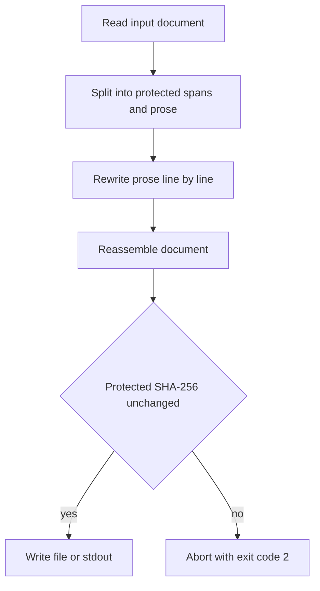

# textscope

Deterministic rewriting for English and Turkish prose, with byte-identical protected zones.

[](https://www.python.org/) [](.github/workflows/ci.yml) [](pyproject.toml) [](LICENSE) [](https://github.com/mehmetefeaytas/textscope/actions/workflows/ci.yml)

textscope replaces AI-typical words and phrases, tidies the grammar that those swaps
break, and then proves with SHA-256 that code, math, citations, URLs and numbers came
through untouched. Rewriting runs offline, uses only the Python standard library, and is
reproducible for a given seed.

> **What it does:** deterministic word- and phrase-level rewriting of English and
> Turkish prose, line by line, with protected zones verified before anything is written.
>
> **What it does not do:** it is not a paraphraser. It does not restructure arguments,
> merge paragraphs, or generate new sentences.
>
> **What it cannot promise:** that a text passes Turnitin, GPTZero or any other
> detector. It does not claim to, and no score from this tool is a detector verdict.

## Install

`textscope-cli` is **not on PyPI yet**. `pip install textscope-cli` will fail; install
from source. Python 3.10 or newer is required. There are no runtime dependencies.

With [uv](https://docs.astral.sh/uv/) (recommended):

```bash
git clone https://github.com/mehmetefeaytas/textscope.git
cd textscope
uv sync
uv run textscope --help
```

With `pip` and a virtual environment:

```bash
git clone https://github.com/mehmetefeaytas/textscope.git
cd textscope
python -m venv .venv
source .venv/bin/activate
pip install -e .
textscope --help
```

The optional LLM backend (`--llm`) needs extra packages:
`pip install -e ".[llm]"`. Everything else works with the standard library alone.

## Quickstart

```console
$ cat notes.txt
It is important to note that organizations must utilize robust frameworks.
$ uv run textscope rewrite notes.txt -o notes.human.txt --seed 7
$ cat notes.human.txt
Note that organizations must use solid frameworks.
```

`notes.txt` is unchanged; the result goes to `notes.human.txt`. With no `-o`, output
goes to stdout. `--dry-run` checks everything and writes nothing.

## How it works

1. **Protect.** `split_protected()` scans the whole document and tags every span that
   must not change: fenced code, math, LaTeX commands and environments, URLs, numbers,
   citation markers, front matter, HTML tags, placeholders and more. LaTeX environments
   are matched with a stack, so nesting and `\begin{document}` behave correctly.
2. **Rewrite per line.** Only unprotected prose is rewritten. Newlines, blank lines and
   indentation are preserved, so a paragraph never collapses into one line.
3. **Reassemble.** Protected spans are placed back byte for byte.
4. **Verify.** `verify_protected()` re-splits both versions and compares the protected
   spans and their SHA-256 hashes.
5. **Write or abort.** If any protected span changed, or their count changed, the
   command prints the violation, exits with code `2`, and writes nothing.



The check runs for single `.txt`, `.md`, `.tex` and code files, and for `.docx` (against
the extracted document text). A `.zip` is transformed entry by entry and is not covered
by one aggregate abort check, so review archive output as well.

## Protected zones

These are the kinds implemented in [`src/textscope/protected.py`](src/textscope/protected.py).
Each one is compared byte for byte, and again by SHA-256, before a write is allowed.

| Kind | Example | Notes |
| --- | --- | --- |
| `front_matter` | `---\ntitle: Paper\n---` | YAML front matter delimited by `---`, only at the very start |
| `html_comment` | `<!-- draft -->` | May span lines |
| `fence` | `` ```python\nx = 1\n``` `` | Backtick fences |
| `fence_tilde` | `~~~text\nx\n~~~` | Tilde fences, anchored to line starts |
| `math_display` | `$$E = mc^2$$` | Display math |
| `math_bracket` | `\[ x^2 \]` | LaTeX display delimiters |
| `math_paren` | `\( x^2 \)` | LaTeX inline delimiters |
| `math_inline` | `$x^2$` | Single-dollar inline math |
| `inline_code` | `` `parse()` `` | Inline code spans |
| `indented_code` | `    x = 1` | After a blank line; list markers excluded |
| `url` | `https://example.com/a?b=1` | Trailing sentence punctuation stays prose |
| `email` | `author@example.org` | |
| `latex_cmd` | `\cite{smith2020}` | Known commands with optional `[opt]` and `{args}` |
| `latex_backslash` | `\foobar` | Any other backslash command |
| `latex_comment` | `% note here` | Only when `%` starts the line, so `42%` stays prose |
| `latex_env` | `\begin{equation} ... \end{equation}` | Stack-matched; `document` is deliberately not protected |
| `md_table` | `\| a \| b \|` | Whole table rows |
| `md_link_target` | `[text](https://example.com)` | Destination only; link text is rewritable |
| `citation_index` | `[4-6]`, `[12]` | Numeric citations |
| `citation_year` | `(Smith et al., 2020)` | Parenthetical author-year citations |
| `citation_year_narrative` | `Smith et al. (2020)` | Narrative author-year citations |
| `html_tag` | `<span class="x">` | Opening, closing and self-closing tags |
| `html_entity` | `&amp;` | Requires a known entity shape and the closing `;` |
| `footnote_def` | `[^1]: source` | Whole definition line |
| `footnote_marker` | `[^1]` | Inline marker only |
| `md_ref_def` | `[docs]: https://example.com` | Markdown reference definitions |
| `doi` | `10.1000/xyz123` | Sentence-final punctuation excluded |
| `isbn` | `ISBN 978-3-16-148410-0` | ISBN-10 and ISBN-13 |
| `arxiv` | `arXiv:2101.00001v2` | Optional version suffix |
| `semver` | `v1.2.3` | Requires at least two dots |
| `emoji` | `:rocket:` | Colon-delimited shortcodes, not clock times |
| `template_var` | `{{ name }}` | Double-brace template variables |
| `template_field` | `{name}` | Single-brace fields |
| `template_env` | `${HOME}` | Shell-style environment variables |
| `printf_placeholder` | `%s` in `value %s here` | `%s`, `%d`, `%i`, `%f`, `%r`; `42%` stays prose |
| `number` | `1,250` | Digit runs with separators |

If a rewrite would disturb any of these, the command aborts rather than writing a
partially protected file. Use `--diff` to inspect the prose changes, and `--json` to
get the `protected_ok` flag and any errors in machine-readable form.

## English support

The English tables in [`src/textscope/rules_en.py`](src/textscope/rules_en.py) are plain
data: a pair list that tests can inspect for duplicates, no-op swaps and synonym chains.

| Table | Entries |
| --- | ---: |
| Word swaps (`WORD_SWAPS_EN`) | 1,368 |
| Phrase swaps (`PHRASE_SWAPS_EN`) | 453 |
| Leading transitions (`LEADING_TRANSITIONS_EN`) | 138 |
| Contractions (`CONTRACTIONS_EN`) | 84 |

Word swaps run after phrase swaps, sentence-initial transitions are removed, and
contractions are applied when the seed enables them. The pipeline then repairs the
damage that word-level substitution tends to cause:

| Repair | What it does | Example |
| --- | --- | --- |
| `a`/`an` repair | Re-picks the article after an adjective swap, including sound-based exceptions (`an honest`, `a university`) | `a effective` → `an effective` |
| Irregular verb agreement | Fixes participles after auxiliaries for the verbs the table touches | `has showed` → `has shown`; also `grew`/`ran`/`went`/`dug` |
| Repeated-starter dedupe | Drops a connector when consecutive sentences open with the same one (`also`, `however`, `therefore`, ...) | `Also, X. Also, Y.` → `Also, X. Y.` |
| Chain breaking | Removes any swap whose output is itself a key, so a second pass cannot rewrite it again | `framework → structure → shape` is cut to one hop |
| Sentence splitting | Splits long sentences at a conjunction or comma only when both halves are real clauses | Guards against 5-word fragments |

Grammar repairs are part of the `balanced` and `aggressive` profiles; `conservative`
performs word swaps only.

Before and after, produced by an actual run of
`textscope rewrite sample.txt --lang en --seed 0`:

```text
Before:
The team has showed that a effective strategy requires a honest assessment.
Moreover, organizations must utilize robust frameworks to facilitate better outcomes.

After:
The team has shown that an effective plan needs an honest review.
What's more, organizations must apply strong frameworks to aid better outcomes.
```

## Turkish support

Turkish is agglutinative, so inflected forms are listed next to their base forms, and
formal verb endings are handled generically by
[`src/textscope/rewrite.py`](src/textscope/rewrite.py). The tables live in
[`src/textscope/rules_tr.py`](src/textscope/rules_tr.py).

| Table | Entries |
| --- | ---: |
| Word swaps (`WORD_SWAPS_TR`) | 531 |
| Phrase swaps (`PHRASE_SWAPS_TR`) | 301 |
| Leading transitions (`LEADING_TRANSITIONS_TR`) | 104 |

The suffix softener keeps one word in, one word out, so `--strict` word counts still
hold. It applies vowel harmony, voicing (`t` → `d` after a voiced consonant), and
Turkish-aware capitalisation (`i` → `İ`, `ı` → `I`) at the start of a sentence.

| Input | Output | Rule |
| --- | --- | --- |
| `göstermektedir` | `gösteriyor` | `-mektedir` → `-yor` |
| `yapılmaktadır` | `yapılıyor` | `-maktadır` → `-yor` |
| `incelenmiştir` | `incelendi` | `-mıştır` → `-di` |
| `yapılmıştır` | `yapıldı` | `-mıştır` → `-dı` |
| `olacaktır` | `olacak` | `-acaktır` → `-acak` |
| `yapılmalıdır` | `yapılmalı` | `-malıdır` → `-malı` |

In the `aggressive` profile the copula `-dır`/`-dir` is also removed where it is safe
(short stems and a small exception list such as `müdür` are left alone).

Before and after, produced by an actual run of
`textscope rewrite sample.txt --lang tr --seed 0`:

```text
Before:
Bu çalışmada yöntem ayrıntılı biçimde açıklanmaktadır.
Bulgular, modelin tutarlı olduğunu göstermektedir.
Gelecek çalışmalarda örneklem genişletilecektir.

Ayrıca sonuçların bağımsız veri setleriyle doğrulanması önerilmektedir.
Bu yaklaşım, bulguların güvenilirliğini artırmalıdır.

After:
Bu çalışmada yöntem ayrıntılı biçimde açıklanıyor.
Bulgular, modelin tutarlı olduğunu gösteriyor.
Gelecek çalışmalarda örneklem genişletilecek.

Sonuçların bağımsız veri setleriyle doğrulanması öneriliyor.
Bu yaklaşım, bulguların güvenilirliğini artırmalı.
```

Language detection is local and dependency-free. It combines Turkish-specific letters
with the ratio of common Turkish function words, so ASCII-only Turkish
(`Bu calisma ...`) is still detected. Pass `--lang en` or `--lang tr` to override.

## Profiles and seeds

Without `--llm`, every rewrite is deterministic for a given input, profile and seed.
The same seed produces the same bytes; a different seed picks different synonyms and
can change how sentences are split.

| Flag | Effect |
| --- | --- |
| `--profile conservative` | Word swaps only. No phrase swaps, transitions, contractions, splitting or grammar repair. |
| `--profile balanced` (default) | Word and phrase swaps, grammar repair, transition cleanup, contractions, sentence splitting. |
| `--profile aggressive` | Balanced plus the larger `EXTRA_*` tables, a fixed split threshold of 6 words, and always-on contractions. Turkish also drops the safe copula endings. |
| `--seed N` (default `0`) | Seeds the choice among listed word variants, the sentence-split threshold (6, 7 or 8), and whether contractions are applied. |
| `--strict` | Keeps the word count identical: only equal-length word pairs are used, and the result is reverted if the count moved. |

`--strict` and `--seed` compose in the `balanced` and `aggressive` profiles: the seed
still chooses variants, but the word count does not change. The `conservative` profile
performs word swaps only and ignores `--strict`.

## Quality gate

[`src/textscope/eval.py`](src/textscope/eval.py) is a deterministic corpus test. It
rewrites 27 bilingual samples (14 English, 13 Turkish) with fixed settings and applies
8 checks to each output — 216 checks in total:

| Check | What it verifies |
| --- | --- |
| `protected_ok` | Every protected span survived byte for byte |
| `structure_ok` | Newline count and blank separators are unchanged |
| `word_budget` | Total words stay within ±20%, and no line loses more than 40% |
| `no_artifacts` | No double spaces, empty brackets, doubled words, lowercase after a period, or dangling conjunctions |
| `language_kept` | The output is still detected as the sample's language |
| `idempotent` | A second rewrite is byte-identical to the first |
| `changed` | The output actually differs from the input |
| `no_fragment_sentences` | The short-sentence count does not increase |

Run it yourself:

```bash
uv run python - <<'PY'
from textscope.eval import evaluate, format_report
print(format_report(evaluate()))
PY
```

Actual output:

```text
textscope quality gate
==============================================================
samples: 27/27 clean    checks: 216/216 passed (100.0%)

sample                       lang  status  failing checks
--------------------------------------------------------------
en_ai_landscape              en    PASS    -
en_ai_education              en    PASS    -
en_ai_health                 en    PASS    -
en_ai_business               en    PASS    -
en_url_numbers               en    PASS    -
en_inline_code               en    PASS    -
en_latex_cite                en    PASS    -
en_single_long_sentence      en    PASS    -
en_plain_baseline            en    PASS    -
en_markdown_heading          en    PASS    -
en_ai_methodology            en    PASS    -
en_ai_policy                 en    PASS    -
en_mixed_protected           en    PASS    -
en_ai_conclusion             en    PASS    -
tr_ai_dijital                tr    PASS    -
tr_ai_egitim                 tr    PASS    -
tr_ai_saglik                 tr    PASS    -
tr_url_sayilar               tr    PASS    -
tr_satir_ici_kod             tr    PASS    -
tr_latex_atif                tr    PASS    -
tr_tek_uzun_cumle            tr    PASS    -
tr_sade_taban                tr    PASS    -
tr_markdown_baslik           tr    PASS    -
tr_yontem                    tr    PASS    -
tr_politika                  tr    PASS    -
tr_karma_korunan             tr    PASS    -
tr_sonuc                     tr    PASS    -

check                         passed  total  rate
--------------------------------------------------------------
protected_ok                      27     27  100%
structure_ok                      27     27  100%
word_budget                       27     27  100%
no_artifacts                      27     27  100%
language_kept                     27     27  100%
idempotent                        27     27  100%
changed                           27     27  100%
no_fragment_sentences             27     27  100%

en: 14/14 samples clean
tr: 13/13 samples clean
```

The gate checks structural and textual invariants, not literary quality. A passing
sample can still read awkwardly; see [Limitations](#limitations).

The unit suite covers the rewriter, protected zones, code-comment handling, idempotency,
regressions and rule-data integrity. CI runs the suite and `ruff check` on Python 3.10,
3.11, 3.12, 3.13 and 3.14:

```bash
uv sync --group dev
uv run pytest
uv run ruff check src tests
```

## Turkish academic corpus scan

[`docs/corpus-tr-report.md`](docs/corpus-tr-report.md) documents a scan of a
**264-paragraph Turkish academic corpus** (12 registers x 22 samples, 10 domains,
3 prose styles) against the rewriter. Every damaged output was traced back to the
rule that caused it and the rule was removed or replaced.

The scan found real damage that unit tests had missed:

| Problem | Example | Count | Fix |
| --- | --- | ---: | --- |
| Broken light-verb phrase | `hem de` -> `ayrıca` after `hem` | 52 | rule removed |
| Wrong case suffix | `ilişkin` -> `hakkında` (`işletmelere hakkında`) | 44 | rule removed |
| Term drift | `doğrultusunda` -> `yönünde` (compliance -> direction) | 44 | rule removed |
| Deleted time/ordinal adverbials | `son yıllarda`, `öncelikle`, `üçüncü olarak` | 16 | removed from transitions |
| Not idempotent | `araştırma` -> `çalışma` -> `çalışma kapsamında` chain | 17 | rule removed |

Result after fixes: **0 grammar breakages, 0 artifacts, 0 structural changes,
0 protected-span changes, 0 idempotency violations** across all 264 samples.
The scan is enforced by [`tests/test_corpus_tr.py`](tests/test_corpus_tr.py), so
the same damage cannot come back unnoticed.

## CLI reference

```text
textscope {clean,rewrite,check,detect,serve} ...
```

| Subcommand | Flag / argument | Meaning |
| --- | --- | --- |
| (global) | `--version` | Print the installed version |
| `clean`, `rewrite` | `input` | File, directory, or `.zip` |
| `clean`, `rewrite` | `-o, --output PATH` | Output file or directory |
| `clean`, `rewrite` | `--dry-run` | Transform and verify, write nothing |
| `clean`, `rewrite` | `--diff` | Print a unified diff of the prose changes |
| `clean`, `rewrite` | `--json` | Print a JSON report (protected status, word counts, metrics) |
| `clean`, `rewrite` | `--seed N` | Variation seed; same seed, same output |
| `clean`, `rewrite` | `--lang {auto,en,tr}` | Language; `auto` detects per document |
| `clean`, `rewrite` | `--profile {conservative,balanced,aggressive}` | Rewrite profile |
| `clean`, `rewrite` | `--in-place` | Overwrite a single input file, keeping a `.bak` copy |
| `clean`, `rewrite` | `--llm PROVIDER:MODEL` | Optional LLM backend, e.g. `openai:gpt-4o-mini` (needs `[llm]`) |
| `rewrite` | `--strict` | Preserve the word count exactly |
| `check` | `input`, `--json` | Local metrics and AI-pattern counts for a file |
| `detect` | `input`, `--json` | Call GPTZero if `GPTZERO_API_KEY` is set; otherwise report that no key was found |
| `serve` | `--host`, `--port` | Start the JSON HTTP server (default `127.0.0.1:8765`) |

Every subcommand accepts `-h, --help`. `clean` only normalises text, so it accepts but
ignores `--seed`, `--lang`, `--profile` and `--llm`; use `rewrite` for those.

The server exposes `POST /clean`, `POST /rewrite` and `POST /check` with a JSON body
such as `{"text": "...", "lang": "en", "seed": 0}`. It binds to localhost by default.

## Formats

| Format | Extensions | Behaviour |
| --- | --- | --- |
| Plain text | `.txt` | Rewritten directly |
| Markdown | `.md`, `.markdown` | Rewritten; tables and link destinations protected, heading markers and layout preserved |
| LaTeX | `.tex` | Prose rewritten; commands, math, line-start comments and non-document environments protected |
| Word | `.docx` | Text nodes in the OOXML are rewritten; protected zones verified on the extracted text |
| Archive | `.zip` | Entries processed by type; unknown or binary entries copied unchanged |
| Source code | `.py`, `.js`, `.ts`, `.tsx`, `.jsx`, `.java`, `.c`, `.cpp`, `.cc`, `.h`, `.hpp`, `.cs`, `.go`, `.rs`, `.rb`, `.php`, `.swift`, `.kt`, `.scala`, `.sh`, `.bash`, `.sql`, `.r`, `.m`, `.lua`, `.pl`, `.pm` | Only comments and docstrings are rewritten |
| Directory | any directory | Recursive; requires `-o OUTPUT_DIR` unless `--dry-run`; only supported extensions are processed |

Unknown extensions are treated as plain text.

In code files a character scanner — not a regex — decides what is a comment. It skips
shebangs, string literals, and `#` characters inside strings or URLs, and it does rewrite
trailing comments such as `return x  # note`.

```bash
textscope rewrite paper.tex -o paper_rw.tex
textscope rewrite report.docx -o report_rw.docx
textscope rewrite archive.zip -o archive_rw.zip
textscope rewrite src/ -o outdir/
```

## Limitations

This section is deliberately blunt. Read it before using the tool on anything that
matters.

- **No detector guarantee.** Turnitin, GPTZero and similar systems score token-level
  perplexity and burstiness, not the presence of a fixed word list. Local metrics and
  the `ai_pattern_total` count from `textscope check` are proxies, not probabilities.
  Passing the built-in quality gate says nothing about a commercial detector's score.
- **Meaning can still drift.** Swaps are context-blind. A noun can be replaced by a
  verb-shaped synonym, or a technical term by a more general one, producing awkward or
  wrong sentences. Always read `--diff` before submitting output.
- **Grammar repair is heuristic.** There is no parser, no part-of-speech tagger and no
  model. The pipeline fixes a/an, a handful of irregular participles, repeated sentence
  starters and dangling splits; it cannot guarantee fluent prose.
- **No offline detector.** `textscope detect` calls GPTZero and requires a paid
  `GPTZERO_API_KEY`. Without a key it only reports that no key was found.
- **Not a substitute for writing.** Using it to misrepresent authorship may violate your
  institution's academic-integrity rules, publishing policies or contract terms. That
  risk is yours, not the tool's.
- **English and Turkish only.** Other languages fall back to English rules, which is
  usually the wrong thing to do.
- **Alpha software.** Version 0.4.0. Interfaces, rule tables and output can change
  between releases; the test suite is the contract, not the version number.

## FAQ

**Does it beat Turnitin?**
No guarantee, and no honest tool can give one. textscope reduces known AI-typical
vocabulary and some structural monotony. Detectors measure different signals, and their
models change. Use `--diff` and judge the prose yourself.

**Is it free?**
Yes. MIT licensed, no account, no telemetry, no paid tier. The only optional cost is a
GPTZero API key if you want `textscope detect`, or an LLM provider if you opt into
`--llm`.

**Does it send my text anywhere?**
No by default. Cleaning, rewriting, metrics and the quality gate run entirely offline
using the Python standard library. The only network paths are `detect` (sends the file
text to GPTZero with your key) and `--llm` (sends text to the provider you name). Neither
runs unless you invoke it.

**Can I use it on a thesis?**
Only if your institution's rules allow the kind of editing you are doing. Many count
undeclared AI-assisted rewriting as misconduct even when a detector would not flag it.
Check the policy first, and disclose when required.

**Why not a paraphraser?**
Because paraphrasing and protection pull in opposite directions. A model that regenerates
sentences cannot promise that `\cite{...}`, equations or code come back byte-identical.
textscope chooses determinism and verifiable protection over fluency, which is why it
edits words and phrases rather than rewriting whole arguments.

## Contributing

See [CONTRIBUTING.md](CONTRIBUTING.md) for development setup, the quality bar,
rule-table conventions and commit style. In short:

- Run `uv sync --group dev`, `uv run pytest` and `uv run ruff check src tests`
  before opening a PR.
- Keep rule tables as plain data in `rules_en.py` / `rules_tr.py`; the integrity tests
  reject duplicate keys, no-op swaps, uncompilable regexes, synonym chains and broken
  Turkish orthography.
- Add a regression test for every bug fix, especially anything touching protected zones
  or idempotency.
- Keep the quality gate green (currently 216/216); if you add a sample, the check count
  grows with it.

Participation is covered by [CODE_OF_CONDUCT.md](CODE_OF_CONDUCT.md); report security
issues privately as described in [SECURITY.md](SECURITY.md). Bug reports and feature
requests go through [GitHub Issues](https://github.com/mehmetefeaytas/textscope/issues).

## License

MIT. See [LICENSE](LICENSE). Copyright (c) 2026 Mehmet Efe Aytaş.

## Acknowledgements

textscope is built on the Python standard library. Packaging uses
[hatchling](https://hatch.pypa.io/) and [uv](https://docs.astral.sh/uv/); tests use
[pytest](https://pytest.org/) and linting uses [ruff](https://docs.astral.sh/ruff/).
The `skills/` directory contains two agent skill definitions (`text-cleaner` and
`turnitin-tester`) that wrap the CLI for assistants. No third-party text corpora are
bundled; the quality-gate samples are written for this project.

## Türkçe Özet

- **Ne yapar:** İngilizce ve Türkçe metinlerde yapay zeka kalıbı sayılan kelime ve
  ifadeleri değiştirir; kod, formül, atıf, URL ve sayıların değişmediğini SHA-256 ile
  doğrular.
- **Ne yapmaz:** Paraphrase aracı değildir; cümleleri yeniden üretmez, argümanı
  yeniden kurmaz ve Turnitin/GPTZero gibi araçlardan geçme garantisi vermez.
- **Kurulum:** Paket henüz PyPI'da değil; `pip install textscope-cli` çalışmaz. Kaynak
  koddan `uv sync` veya `pip install -e .` ile kurulur.
- **Kalite kapısı:** 27 örnek (14 İngilizce, 13 Türkçe) üzerinde 8 kontrol, toplam
  216/216 geçer. Bu, yapısal ve koruma kontrolleridir; edebi kalite ölçüsü değildir.
- **Lisans:** MIT. Varsayılan olarak tamamen çevrimdışı çalışır; yalnızca `detect`
  (GPTZero anahtarıyla) ve `--llm` ağa erişir.
