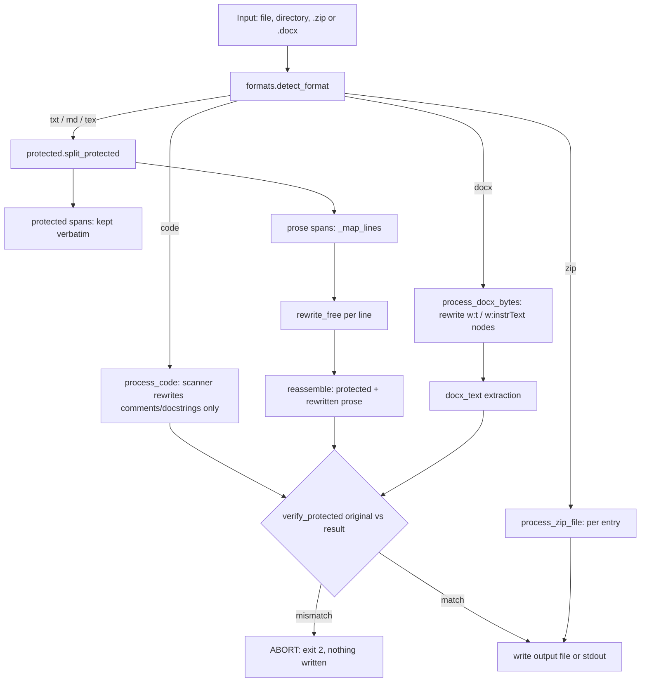

# Architecture

textscope is a single-pass, deterministic text transformer with one hard
invariant: **everything it classifies as protected comes out byte-identical,
or the command aborts without writing.** There is no model in the default path
and no runtime dependency outside the standard library.

The package is deliberately flat: each module owns one concern, and the data
tables are separate from the logic that applies them.

## Module map

| Module | Responsibility |
| --- | --- |
| [`cli.py`](../src/textscope/cli.py) | Argument parsing, file/directory/`.zip`/`.docx` routing, reporting, and the abort-on-protected-violation exit path. |
| [`clean.py`](../src/textscope/clean.py) | Normalisation only: strips zero-width/format characters, applies NFC, expands ligatures, normalises whitespace, dashes and quotes, leaving protected spans untouched. |
| [`rewrite.py`](../src/textscope/rewrite.py) | The rewriter: language detection, variant selection, word/phrase swaps, English grammar repair, Turkish suffix handling, transition cleanup, sentence splitting, and per-line document mapping. |
| [`rules_en.py`](../src/textscope/rules_en.py) | English rule data only — word pairs, phrase regex pairs, leading transitions, contractions, aggressive extras and seed-driven variants. |
| [`rules_tr.py`](../src/textscope/rules_tr.py) | Turkish rule data only — word/phrase/transition tables, variants and the stopword set used for language detection. |
| [`protected.py`](../src/textscope/protected.py) | Protected-zone patterns, LaTeX environment matching, span splitting/reassembly, hashing and `verify_protected()`. |
| [`formats.py`](../src/textscope/formats.py) | Format detection and non-prose I/O: the code comment/docstring scanner, `.docx` XML text-node rewriting, text extraction, and `.zip` entry processing. |
| [`metrics.py`](../src/textscope/metrics.py) | Local statistics: word count, sentence lengths, burstiness, type-token ratio, character/word entropy, trigram repetition, rare-word ratio, sentence-length variance. |
| [`detect.py`](../src/textscope/detect.py) | Optional external detector client (GPTZero); only runs when `GPTZERO_API_KEY` is set. |
| [`llm.py`](../src/textscope/llm.py) | Optional LLM rewrite backend (`openai`/`anthropic`), imported lazily behind the `llm` extra. |
| [`server.py`](../src/textscope/server.py) | Standard-library `HTTPServer` exposing `POST /clean`, `/rewrite` and `/check`; local-only, no authentication. |
| [`eval.py`](../src/textscope/eval.py) | Deterministic quality gate: rewrites a bilingual corpus and checks protection, structure, word budget, artifacts, language, idempotency and fragments. |
| [`diff.py`](../src/textscope/diff.py) | Thin `difflib` wrapper used by `--diff`. |

## The rewrite pipeline

Protection happens before any rewriting, and verification happens after
reassembly. Binary formats take a parallel path: `.docx` rewrites only the
`<w:t>` / `<w:instrText>` text nodes and verifies against the extracted
document text; `.zip` applies the same text logic entry by entry, but the
archive path writes the new archive without a document-level
`verify_protected()` call of its own. Code files bypass the span splitter
entirely and use the comment/docstring scanner, then go through the normal
text verification.

`rewrite_free()` applies, in order: phrase swaps, word swaps, grammar repair
(English) or Turkish suffix softening, leading-transition removal, contractions,
duplicate-starter cleanup, long-sentence splitting, and duplicate-word collapse.
`--strict` restricts itself to one-word-to-one-word swaps and restores the input
if the word count moved. The `conservative` profile applies only word swaps;
`aggressive` adds the extra tables and a lower split threshold.

## The span and overlap algorithm

`split_protected(text)` in
[`protected.py`](../src/textscope/protected.py) returns an alternating list of
`Span(text, protected, kind)` objects whose concatenation is exactly the input.

1. Every pattern in `_PROTECTED_RES` is run over the whole document
   (`finditer`), producing `(start, end, kind, matched_text)`. LaTeX
   environments are added separately by `_latex_env_spans()`, which walks
   `\begin{...}`/`\end{...}` tokens with a stack so nesting is resolved
   correctly and `\begin{document}` does not freeze the file.
2. Matches are sorted by **start offset ascending**, breaking ties by **longest
   match first** (`(start, -(end - start))`).
3. A greedy pass keeps a match only if its start is at or after the end of the
   last accepted match (`s >= cur_end`). This yields a maximal, non-overlapping
   set: earlier constructs win, and at the same start the longer construct wins.
   The rest are discarded, so the earliest-starting construct wins, and a later
   or broader match cannot split a span that has already begun.
4. The gaps between accepted spans become unprotected `Span`s. Empty strings are
   dropped, and the remainder is joined in order.

Because the algorithm only *partitions* the original string and never rewrites
a protected span, `reassemble(split_protected(text)) == text` holds for every
input. That byte-identical reassembly is what makes the safety claim testable:

- A protected number, citation, URL or equation keeps its exact characters —
  no Unicode normalisation, whitespace change or case folding can leak in.
- Rewriting can be applied to prose only, without re-parsing the whole document
  after every rule, so structure (line breaks, blank lines, indentation) is
  preserved.
- `verify_protected()` can compare spans by identity rather than by heuristic:
  any drift shows up as a changed span text or a changed span count, not as a
  plausible-looking diff.

## How `verify_protected` works

`verify_protected(original, result)` re-runs `split_protected()` on **both**
documents, because the result must be classified independently — a construct
that was protected before but is no longer recognised has effectively been
destroyed.

1. Extract the protected span texts from each side, in document order.
2. Compare counts. A difference is reported as
   `protected span count changed: N -> M` and fails immediately.
3. Compare texts pairwise. Each mismatch is reported as
   `protected span N changed`.
4. Independently, `protected_hashes()` computes a SHA-256 digest per protected
   span, keyed `kind:index`. The two digest lists must be equal; a mismatch
   that the text comparison somehow missed is reported as
   `protected hash mismatch`.
5. The CLI treats any error as fatal: it prints `ABORT: protected zone
   violation`, exits with code 2, and does not write the output (stdout is not
   emitted either). For `.docx`, the comparison runs on `docx_text()` extracted
   from the original and rewritten packages, so the guarantee covers the
   visible document text rather than the raw XML.

The check is intentionally conservative. A rewrite that drops, duplicates or
reclassifies a protected construct is rejected even if the human-visible text
looks the same, because "looks the same" is not the guarantee being offered.

## Extending it safely

**A rule** belongs in [`rules_en.py`](../src/textscope/rules_en.py) or
[`rules_tr.py`](../src/textscope/rules_tr.py) — never in `rewrite.py`. Add a
word pair to `_WORD_PAIRS_*` (or the extras dict), a phrase to the phrase table,
and a variant only if the key already exists. The invariants are documented in
[CONTRIBUTING.md](../CONTRIBUTING.md#how-the-rule-tables-work) and enforced by
[`tests/test_rules_en.py`](../tests/test_rules_en.py) /
[`tests/test_rules_tr.py`](../tests/test_rules_tr.py): unique lowercase keys, no
no-op swaps, compiling patterns without backreferences, no variant that is
itself a key, no protected statistical vocabulary, and correct Turkish
orthography. After a data change, run the quality gate as well as the unit
tests — a rule can be individually valid and still damage a corpus sample.

**A protected kind** belongs in `_PROTECTED_RES` in
[`protected.py`](../src/textscope/protected.py), or in `_latex_env_spans()` if
the construct is a matched pair. Use the narrowest anchored pattern that
matches the construct and its terminator; broad patterns win the overlap
resolution and can swallow prose. Keep the reassembly guarantee, add a case to
[`tests/test_protected_extra.py`](../tests/test_protected_extra.py) covering
protection, surrounding prose and `rewrite_text()` survival, and run the whole
suite to catch patterns that also match generated text (those turn into aborts).

**A format** starts in `detect_format()` in
[`formats.py`](../src/textscope/formats.py), then needs a branch in
`_transform_text()`/`_process_file()` in [`cli.py`](../src/textscope/cli.py),
an entry in `SUPPORTED_EXTS`, and — for archives — handling in
`process_zip_file()`. A new binary format should preserve every part it does not
rewrite and must call `verify_protected()` on extracted text, as the `.docx`
path does. Test single-file, directory and archive inputs.
